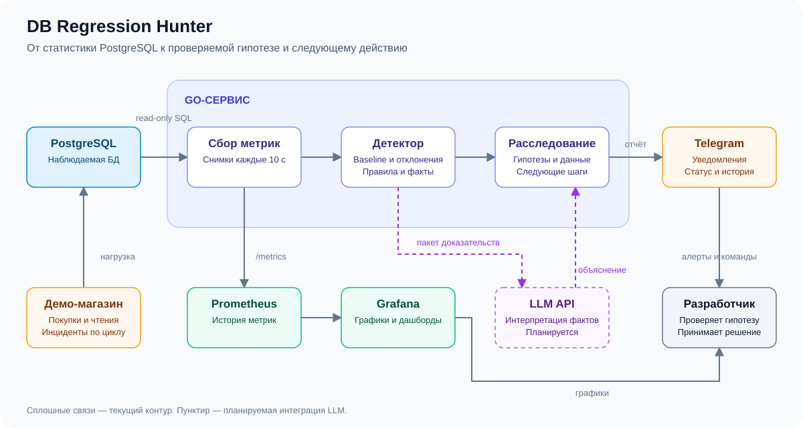
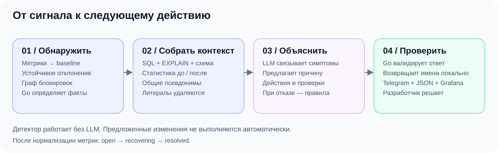

# DB Regression Hunter

**От замедлившегося PostgreSQL — к расследованию с фактами и планом действий.**

Вчера API отвечал быстро, сегодня — в десять раз медленнее. Трафик прежний, CPU свободен, ошибок нет. Hunter обнаруживает отклонение, собирает контекст PostgreSQL и помогает выяснить, что произошло: кто держит блокировку, какой SQL замедлился и чем подтвердить гипотезу.

Хакатонный проект на **Go**. Интерфейс — **Telegram + Grafana**, запуск — **Docker Compose**, объяснение причин — опциональная **LLM через Gonka / OpenBroker**.

[Запуск](#быстрый-запуск) · [Демо](#демонстрация) · [Архитектура](#архитектура) · [LLM-контракт](docs/llm-contract.md)

## Что умеет

- Самостоятельно накапливает baseline — обычный уровень метрик — и обнаруживает устойчивые отклонения.
- Находит корневых блокировщиков и цепочки ожидания, долгие запросы, всплески активности, временных файлов и deadlock.
- Отслеживает замедление отдельных SQL по `pg_stat_statements`, сравнивая запрос с его собственным baseline.
- Собирает SQL, оценочный план, схему и статистику связанных таблиц для расследования.
- Отправляет алерт в Telegram, затем — объяснение LLM с доказательствами, рекомендациями и проверками. При отказе модели использует вывод по правилам.
- Подтверждает восстановление по нескольким нормальным наблюдениям подряд. Grafana показывает метрики до, во время и после инцидента.

## Архитектура



`hunter` — один Go-сервис: сборщик, детектор, подготовка доказательств, LLM-анализ и Telegram/HTTP-интерфейс. `demo` создаёт нагрузку в отдельной демонстрационной БД. Prometheus хранит временные ряды, Grafana получает готовый дашборд при запуске.

### Как проходит расследование



**Детерминированно, в Go:** каждые 10 секунд собираются метрики, проверяются пропуски и сбросы счётчиков, считаются дельты и baseline. Устойчивое превышение открывает инцидент; граф ожиданий указывает корневых блокировщиков. Один инцидент может содержать несколько подтверждённых `findings`.

**Через LLM:** после обнаружения сервис ждёт связанные сигналы (по умолчанию 25 секунд) и передаёт отобранные доказательства: показатели до/после, сессии, SQL, JSON-планы и метаданные таблиц. Модель объясняет вероятную причину и предлагает действия. Go проверяет структуру ответа и ссылки на факты. Запуски ограничены одним анализом одновременно и интервалом не менее двух минут; повторный анализ только из-за изменения существующего инцидента пока не запускается.

**Граница данных:** API и Telegram содержат реальные имена объектов и доступный SQL. Перед отправкой в LLM идентификаторы и имена приложений заменяются согласованными псевдонимами, литералы и комментарии удаляются. Имена в проверенном ответе восстанавливаются локально. Строки таблиц и гистограммы не собираются; структура схемы и числовая статистика передаются модели.

EXPLAIN выполняется **без ANALYZE**: это новый оценочный generic plan под ролью мониторинга, а не план конкретного медленного выполнения. Предложенный моделью SQL автоматически не выполняется.

### Метрики и сценарии детектора

| Источник | Какие данные используем |
| --- | --- |
| `pg_stat_activity`, `pg_blocking_pids`, `pg_locks` | Активные сессии, возраст запросов и транзакций, ожидания, граф блокировок |
| `pg_stat_database` | Commit/rollback, deadlock, чтения и попадания в кеш, временные записи |
| `pg_stat_statements` | Вызовы, среднее время выполнения за интервал, строки, чтения и временные блоки по SQL |
| Системные каталоги и статистика таблиц | Колонки, типы, ограничения, индексы и их валидность, размеры, оценка числа строк, VACUUM/ANALYZE, статистика колонок |

| `finding` | Что замечено |
| --- | --- |
| `query_age_regression` | Устойчиво вырос возраст активного запроса |
| `lock_wait` | Рост возраста запросов сопровождается ожиданием Lock |
| `lock_contention` | Найдены корневые блокировщики и цепочки ожидания |
| `idle_in_transaction` | Корневой блокировщик простаивает с открытой транзакцией |
| `active_sessions_surge` | Устойчиво выросло число активных сессий |
| `temp_file_growth` | Устойчиво выросла скорость записи во временные файлы |
| `deadlock` | PostgreSQL зарегистрировал взаимную блокировку |
| `sql_execution_regression` | Конкретный SQL замедлился относительно собственного baseline |

Эти сигналы описывают наблюдаемые факты. Первопричина — гипотеза, которую нужно проверить; возраст запроса сам по себе не измеряет latency API.

## Быстрый запуск

Нужны **Docker и Docker Compose v2**. Go на хосте не требуется.

```sh
cp .env.example .env
docker compose up --build -d
```

Если `.env` уже существует, сохраните его и проверьте настройки по `.env.example`. Без токенов стенд запускается с детектором, API и Grafana.

| Куда перейти | Что увидеть |
| --- | --- |
| [Grafana](http://localhost:3000/d/hunter/postgresql-investigation) | Дашборд PostgreSQL; логин `admin`, пароль `local-demo-password` или ваш `GRAFANA_ADMIN_PASSWORD` |
| [API status](http://localhost:8080/api/status) | `healthy`, последний снимок метрик и накопленные инциденты |
| [Prometheus](http://localhost:9090) | Временные ряды метрик Hunter |

```sh
curl -fsS http://localhost:8080/readyz
curl -fsS http://localhost:8080/api/status
docker compose logs -f hunter demo
```

`/readyz` возвращает `ready`, когда сбор метрик работает. После прогрева `latest.sql.status` становится `ready`; обнаруженные эпизоды появляются в `incidents[]`. Состояния инцидента: `open → recovering → resolved`.

### Telegram и LLM

Заполните в `.env` нужные значения:

```dotenv
TELEGRAM_BOT_TOKEN=<токен от BotFather>
TELEGRAM_CHAT_ID=<ID вашего чата>
GONKA_API_KEY=<ключ OpenBroker>
```

Telegram и LLM включаются независимо. Для Telegram нужны оба поля; откройте диалог с ботом и отправьте `/start`. Если Grafana открывается с другого устройства, задайте доступный ему `GRAFANA_URL` вместо localhost.

```sh
docker compose up -d hunter
```

В Telegram сначала приходит алерт со ссылкой на Grafana и JSON-контекстом. Готовый анализ приходит ответом на алерт: **«Причина → Почему → Что сделать»**, дополнительные сведения свёрнуты. При ошибке модели сообщение помечается «Предварительно, без LLM».

Команды: `/status` — состояние БД, `/incidents` — последнее расследование, `/incident <ID>` — расследование по ID. Готовый анализ также добавляется в карточку инцидента.

Полный результат доступен в [GET /api/analyses](http://localhost:8080/api/analyses), когда задан `GONKA_API_KEY`: `pending` — выполняется, `done` — ответ LLM, `fallback` — вывод по правилам. Без ключа маршрут не подключается. Параметры моделей и задержки — в [.env.example](.env.example), формат данных — в [LLM-контракте](docs/llm-contract.md).

## Демонстрация

Демо имитирует магазин: покупатели, товары, остатки, заказы и платежи; параллельно выполняются чтения и покупки. После заполнения БД идёт **около 4 минут 10 секунд прогрева**, затем запускаются инциденты: **60 секунд проблемы → 60 секунд обычной работы**. Сценарии перемешиваются каждый круг, без повторов подряд.

| Сценарий demo | Имитация | Ожидаемые сигналы |
| --- | --- | --- |
| `row_lock` | Транзакция удерживает строку остатков | Долгие запросы, ожидания и корневой блокировщик |
| `table_lock` | `ACCESS EXCLUSIVE` на таблице заказов | Блокируются чтения и покупки |
| `lock_chain` | Блокировщик сам ждёт другую транзакцию | Цепочка ожиданий и корневой PID |
| `slow_report` | Долгая агрегация с `pg_sleep` | Долгий запрос без ожидания Lock |
| `temp_spill` | Сортировки с маленьким `work_mem` | Рост временных записей |
| `session_burst` | Восемь дополнительных долгих запросов | Всплеск активности и возраста запросов |
| `deadlock` | Транзакции захватывают строки в разном порядке | Deadlock и откат выбранной PostgreSQL транзакции |

SQL-регрессия обнаруживается отдельно, когда у запроса накоплен baseline и достаточно вызовов за интервал; каждый demo-сценарий не обязан вызывать `sql_execution_regression`.

**Для показа:** откройте Grafana и Telegram, дождитесь первого сценария, сравните график с `findings`, SQL и корневым PID в инциденте. После завершения нагрузки проследите восстановление и прочитайте объяснение LLM, если она включена.

Для фокуса на блокировках задайте в `.env` `DEMO_SCENARIOS=row_lock,lock_chain`. Время регулируется через `DEMO_WARMUP`, `DEMO_INCIDENT_DURATION`, `DEMO_COOLDOWN`; слишком короткий прогрев не позволит накопить baseline.

```sh
# Применить настройки и заново пройти прогрев
docker compose up -d hunter demo
docker compose restart hunter demo

# Остановить стенд, сохранив данные
docker compose down
```

## Подключение своей БД

Задайте `DATABASE_URL`, доступный из контейнера Hunter. Генератор `demo` всегда работает только с локальной Compose-БД и не использует этот адрес.

Для полного SQL-контекста требуется **PostgreSQL 16+**, включённый в `shared_preload_libraries` модуль `pg_stat_statements`, расширение в наблюдаемой БД и расчёт `query_id`. Роли мониторинга нужны `CONNECT`, `pg_monitor`, доступ к схемам и права на объекты для EXPLAIN соответствующих запросов. Пример локальных прав — [init.sql](deploy/postgres/init.sql) и [schema.sql](internal/demo/schema.sql); для своей БД выдавайте права явно. При недоступном источнике сервис отмечает неполноту данных, остальные сигналы продолжают работать.

## Разработка и границы MVP

```sh
# Go 1.23+
go test -race ./...
go vet ./...
go build -o bin/hunter ./cmd/hunter
```

Точки входа — `cmd/hunter` и `cmd/demo`; основная логика — `internal/`; Compose-инфраструктура — `deploy/`.

Сейчас один экземпляр наблюдает одну БД. До 100 инцидентов и 50 анализов хранятся в памяти и теряются при рестарте. API без авторизации, порты стенда привязаны к localhost; доставка Telegram без повторов. Метрики приложения, хоста и события деплоя пока не подключены.

Дальнейшее развитие: фактические планы и их сравнение, повторный анализ при новых доказательствах, постоянное хранилище и связь деградации БД с latency приложения.
